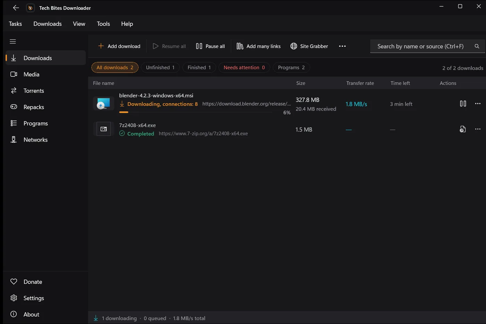
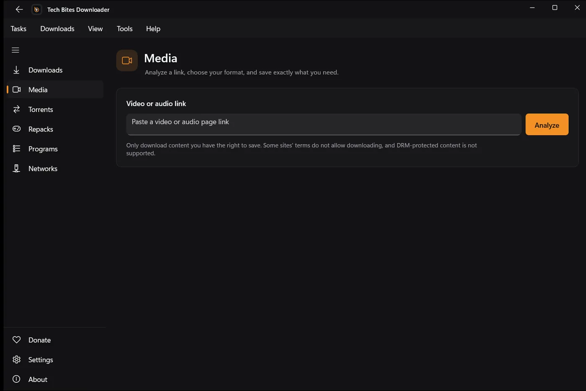
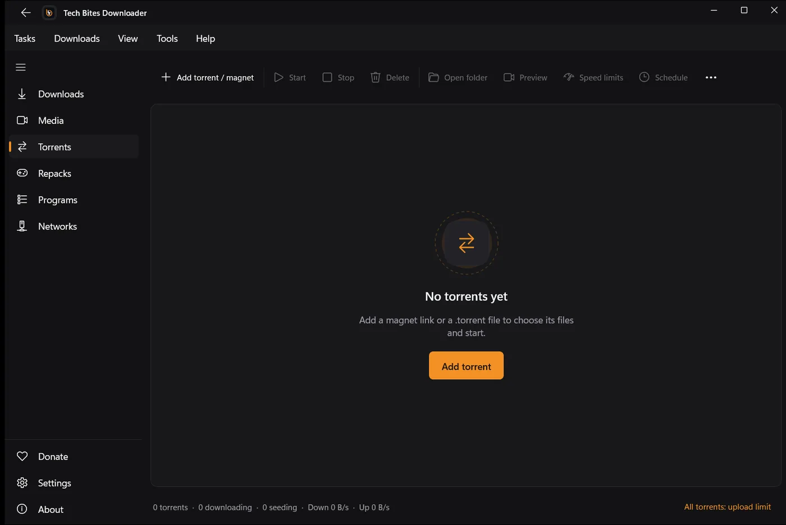
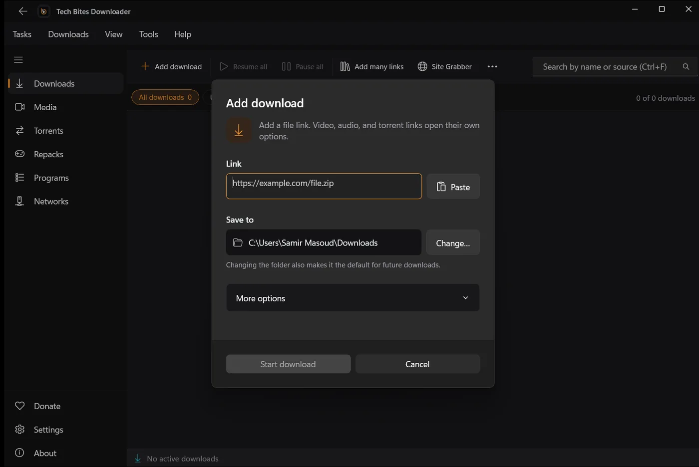

# TechBites Downloader

**Download anything. Keep everything. Pay nothing.**

A fast, free download manager for Windows. Videos, music, torrents, whole sites and big files, all in one clean app, with no account and no ads.

---

## Why Fetch

| | |
|---|---|
| **100% free** | Not a trial, not freemium. No ads, no locked features. |
| **No account** | Nothing to sign up for. |
| **Private** | Your links, files and torrents are never sent to us. |
| **Open updates** | New versions come from this public repo. |
| **Signed installer** | Published by Samir Masoud. |

## Features

**Fast file downloads**
- Splits big files into parts that download at the same time; a part that finishes early helps the slowest one.
- Pause and resume any time, even after a restart. If your network drops, it waits and carries on.
- Smart retry on 401/403, refresh an expired link without starting over, per-site connection limits and speed presets.

**Video and audio**
- Paste a page link and pick from every quality and format: video, audio only, full playlists, embedded subtitles.
- HLS (m3u8) streams, including AES-128. Powered by yt-dlp and FFmpeg, which update themselves.

**Torrents**
- Magnet links and `.torrent` files. Choose files before you start, pause, resume, recheck.
- Stop seeding at a ratio or a time, with seeding time windows.

**Browser integration**
- Extensions for **Chrome, Edge, Brave and Firefox**, set up with one click from the first-run screen.
- Sends downloads to the app, and a video button on supported pages lists the qualities.

**Site Grabber**
- Give it a start page and it lists every file it finds. Control depth, pages and filters. Respects `robots.txt`.

**Queues, data and more**
- Queues with a scheduler (start times, days of the week) and a limit on parallel downloads.
- Monthly data budget, metered-network profiles, filename templates and automatic category folders.
- Modern Windows 11 look in dark and light, in English and Arabic with a true right-to-left layout.

## Screenshots

<table>
  <tr>
    <td></td>
    <td></td>
  </tr>
  <tr>
    <td align="center">Media: paste a link, pick the quality</td>
    <td align="center">Torrents and magnets in the same app</td>
  </tr>
  <tr>
    <td colspan="2"></td>
  </tr>
  <tr>
    <td colspan="2" align="center">Add a download and choose where to save</td>
  </tr>
</table>

## Install

1. Open the [latest release](https://github.com/SamirMasoudTechBites/Tech-Bites-Downloader/releases/latest) and download **`TechBitesDownloader-win-Setup.exe`**.
2. Run it. If Windows SmartScreen shows a warning, click **More info → Run anyway**. The installer is signed by *Samir Masoud*; new apps take time to build SmartScreen reputation.
3. Follow the first-run screen to connect your browsers.
4. That's it. The app updates itself, so you never need to download it again.

**Requirements:** Windows 10 (1809 or newer) or Windows 11, 64-bit · about 1 GB free for the app and its media tools · an internet connection.

## Privacy

- No tracking of the links you download, the files you save or the torrents you join.
- No account, no device ID, no license server.
- Cookies you import for private sites are encrypted on your PC with Windows DPAPI and never uploaded.
- Anonymous crash reports (Sentry) with usernames and URL queries removed, so bugs can be fixed.
- Update checks are plain requests to GitHub. Nothing else about you is sent.

## FAQ

<b>Is it really free?</b>
Yes. No trial, no ads, no account. Donations are optional.

<b>Does it work on Mac or Linux?</b>
Not yet. Windows only.

<b>Which sites are supported?</b>
Thousands of video and audio sites through yt-dlp, plus any direct file link, HLS stream, magnet link or <code>.torrent</code> file. DRM-protected streams (like Netflix) are not supported.

<b>Can it download from YouTube?</b>
Yes, through the Media page and the browser extension. Only download content you have the right to save.

<b>Why does Windows warn me?</b>
SmartScreen is cautious with newer apps. The installer is signed by Samir Masoud. Choose More info → Run anyway.

<b>How do I report a bug or ask for a feature?</b>
Open an <a href="https://github.com/SamirMasoudTechBites/Tech-Bites-Downloader/issues">issue</a> or ask in the <a href="https://discord.gg/TudCkmZqss">Discord</a>.

## Support the project

Fetch is built and maintained by one creator, **Samir Masoud**. If it saves you time, a small donation keeps it updated, keeps yt-dlp and FFmpeg support current, and pays for new features. Sharing the app helps just as much.

Free ways to help: ⭐ star this repo, share it with a friend, or report a bug.

---

## بالعربي

**تك بايتس فيتش** برنامج تنزيل سريع ومجاني لويندوز: فيديو وصوت وتورنت وملفات كبيرة ومواقع كاملة، كله في برنامج واحد. من غير حساب ومن غير إعلانات.

- **مجاني 100%**: مش تجربة ولا نسخة ناقصة.
- **تنزيل أسرع**: الملف بيتقسم لأجزاء بتتنزل مع بعض، ولو النت فصل بيكمل لوحده.
- **فيديو وصوت**: الصق الرابط واختار الجودة، وPlaylist كاملة وترجمة.
- **تورنت**، **إضافة للمتصفح** (Chrome وEdge وBrave وFirefox)، و**Site Grabber**.
- **عربي وإنجليزي** من اليمين للشمال بجد.

**التحميل:** من [آخر إصدار](https://github.com/SamirMasoudTechBites/Tech-Bites-Downloader/releases/latest) نزّل `TechBitesDownloader-win-Setup.exe` وشغّله. لو SmartScreen ظهر دوس More info ثم Run anyway.

التطبيق من تطوير وصيانة صانع محتوى واحد: سمير مسعود. لو وفّر عليك وقت، أي دعم بسيط بـ [InstaPay](https://ipn.eg/S/samirmasoudtb/instapay/7umLwP) بيساعد في تحديثه باستمرار، ومشاركته مع أصحابك بتفرق معانا برضه.

---

TechBites Fetch uses yt-dlp, FFmpeg and other open-source components. © 2026 Samir Masoud / Tech Bites

